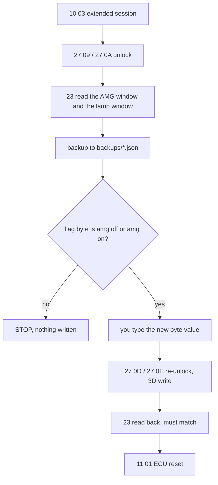

# ic204amg

Standalone tool to enable the **AMG instrument-cluster menu** on a Mercedes IC204 cluster
(W204, W212, C207, C218/X218) by a direct EEPROM write over UDS, through a Tactrix Openport 2.0
(J2534). Pure Python, 32-bit, Windows laptop, no Vediamo or Xentry needed.

You get an AMG page (engine/gearbox oil temp, gear, RACETIMER, depending on the bits). Dial
faces, needle colours and speedometer scaling are untouched.

> [!WARNING]
> **This writes raw bytes to your instrument cluster's EEPROM.** That EEPROM also holds
> odometer and vehicle-binding data. A wrong offset, a wrong value, or an interrupted write can
> corrupt the cluster or brick it. The tool only writes the configured AMG/lamp windows and
> verifies every write by read-back, but **you** are responsible for the values in your
> profile. Only use it on a cluster you own or are authorised to modify; odometer tampering is
> illegal in most jurisdictions. No warranty - see `LICENSE`. **Always `readonly` first and keep
> the backup.**

Claims and hex values are tagged `[S]` primary source, `[V]` verified on a car, `[C]` unverified
community report; see [Sources](#sources).

## Requirements

- **Car:** an IC204-family instrument cluster. See [Known results](#known-results) for the
  clusters it has worked on; anything else needs its own profile
  ([Other clusters](#other-clusters)).
- **Interface:** a Tactrix Openport 2.0 with the Tactrix driver installed
  (`C:\Windows\SysWOW64\op20pt32.dll`).
- **Laptop:** Windows. The J2534 DLL is 32-bit only; the release bundle ships its own 32-bit
  Python. Close Vediamo/Xentry if present, the Openport is exclusive.
- **Power:** a charger holding the battery at ~13.5 V, ignition on, engine off. Writes are
  refused below 12.5 V.
- **The cluster's 10-digit software part number**, from the IC204 identification in
  Xentry/Vediamo/DAS. It selects the seed-key table.

## Quick start

1. **Install:** download `ic204amg-win32.zip` from the
   [releases](https://github.com/MrExplode/IC204-AMG/releases) and unzip it anywhere, e.g.
   `C:\work\amg`. Nothing is installed; delete the folder to undo.
2. **Configure:** copy `car.example.toml` to `car.toml` and fill in `sw`. The CAN ids, baud and
   DLL path ship with the IC_204 defaults; `car.example.toml` documents every key, and each can
   also be given on the command line (`--sw`, `--txid`, `--rxid`, `--baud`, `--dll`). A wrong
   `sw` is a rejected key, and the cluster counts failed attempts.
3. **Run**, in the unzipped folder, in this order:

```
ic204amg selftest      # seed-key vectors, udsoncan, DLL load, active profile; no cable
ic204amg probe         # cable: firmware/DLL version, battery voltage; no bus traffic
ic204amg readonly      # unlock + back up the profile's windows; writes nothing
ic204amg write [--expect backups\<earlier>.json]
ic204amg lampfix       # only if a lamp misbehaves afterwards, see Lamp fix
ic204amg restore backups\<file>.json [--lamp]
```

`write` switches between amg off and amg on each run, so run it once. Every writing command:

- re-reads the windows and saves a fresh backup to `backups\` first
- refuses below 12.5 V (`--ignore-battery` overrides)
- asks you to type the new byte value, then unlocks again right before the write, because
  security access lapses while the prompt waits
- unlocks for the write at SecurityAccess `0x0D`, since `0x09` was refused (`7F 3D 33`) `[V]`;
  reads use `0x09`. If a write is refused, try another `--write-level` (`0x01 0x03 0x09 0x0D`)

Exit codes: 0 ok, 1 usage/config, 2 STOP (a safety rule halted it), 3 UDS/transport error. Copy
`backups\` and `logs\` off the laptop after each session.

**Rollback:** `restore backups\<file>.json` writes that backup's AMG window back; `--lamp` also
restores its lamp window. Windows that already match are skipped, so restoring a backup taken
after amg on with `--lamp` only resets the lamp byte. The tool only changes bytes it holds a
byte-exact copy of, so every state is reversible over OBD as long as the cluster still talks.

## Known results

| Car | Cluster SW | AMG menu | Lamp side effect after amg on | Tier |
| --- | --- | --- | --- | --- |
| 2013 C220 CDI (S204), colour cluster | `2049022903` | works: `0x01D0` byte 0 `FF` amg off, `FC` amg on | preheat lamp stays on after the ignition-on check | `[V]` author |
| 2012 CLS 350 CDI (C218/X218) | `2189028400` | works | preheat and ESP lamps stay on until the engine starts | `[V]` [#2][^issue-2] |

### Lamp fix

On some clusters amg on brings a lamp side effect (wrong ESP/CNG/preheat lamp). The reported fix
is the last byte of the `0x0260` window (`0x0269`), written to `60` `[C]`[^mcs][^autogmt-w204];
`lampfix` does exactly that. Results so far:

| Car | `0x0269` | Binary | Result |
| --- | --- | --- | --- |
| W204 | `42` | `01000010` | factory value |
| W204 | `40` | `01000000` | no change from `42` |
| W204 | `60` | `01100000` | preheat lamp fixed; fog indicator always on, parking indicator lights with low beam, low beam indicator with high beam, high beam indicator with fog lights |
| CLS 350 CDI | `20` | `00100000` | factory value |
| CLS 350 CDI | `60` | `01100000` | no change from `20` |

Setting bit 5 (`0x20`) is what changed the W204, and the CLS had it from the factory, so `60` is
not a universal fix. The byte differs per car and there is no way yet to predict the right
value; if a value does not help, `restore <backup taken after amg on> --lamp` puts the original
back.

## Other clusters

- **Seed-key `[S]`[^unlockecu]:** 83 software part numbers in six families (197902, 204442,
  204902, 212442, 212902, 218902), the IC204 entries of UnlockECU's `db.json`, shipped as
  `ic204amg/ic204_salts.json`. `ic204amg selftest` lists them; adding one is copying its four
  `Salt` values from there.
- **AMG recipe:** a *profile*: the write windows, the flag byte with its amg off and amg on
  values, and the lamp fix. The default is the W204 one above; override it with `[amg]`/`[lamp]`
  in `car.toml` (documented in `car.example.toml`). The tool only writes the profile's windows
  and stops if the flag byte is neither the amg off nor the amg on value, so a new cluster needs
  no code change.
- **CAN ids:** `0x60A`/`0x481` at 500 kbit for IC_204 `[S]` (`tools/cbf/ic204_comparams.txt`).
  For any other cluster take them from its CBF ([below](#dumping-can-ids-from-a-cbf)) or a
  Vediamo channel trace. Never guess them.

Community-reported values, **unverified** - a starting point only:

| Cluster | AMG bytes | Tier | Source |
| --- | --- | --- | --- |
| Monochrome | `0x01D0` bytes 0-1 = `10 20` | `[C]` | [MHH][^mhh-lampfix] |
| W204 without Airmatic | `0x01D0` byte 0 = `40` | `[C]` | [MHH][^mhh-v2] |
| Factory-AMG clusters | `0x0212`-`0x0213` = `FF FF` | `[C]` | [MotorCarSoft][^mcs] |
| Pre-facelift mono (SW `2044421921`) | `10 20`/`40`/`60` → no change | `[C]` | [MHH][^mhh-change] |

`10 20` is a two-byte flag, which the single-byte profile cannot express. Some cluster software
ignores the AMG flag entirely; that needs a firmware change outside this tool
`[C]`[^mbtools][^mhh-change].

### Dumping CAN ids from a CBF

`tools/cbf/CbfComParams.cs` dumps a CBF's comparameters using CaesarSuite's `Caesar.dll`. On a
Windows machine, in one folder: `CbfComParams.cs`, `build.cmd`, `Caesar.dll` and
`Newtonsoft.Json.dll` (from `CaesarSuite_2022-04-28.zip`, needs .NET Framework 4.6+), and the
cluster's CBF:

```
build.cmd
CbfComParams.exe IC_204_Xentry.CBF IC_204 > ic204_comparams.txt
```

Take `CP_REQUEST_CANIDENTIFIER`, `CP_RESPONSE_CANIDENTIFIER` and `CP_BAUDRATE` of the HS-CAN
(UDS) subtype.

## How it works

The AMG pages of a non-AMG IC204 are enabled in EEPROM, not in variant coding or flash
`[C]`[^mhh-coding]. So this is a UDS `WriteMemoryByAddress` (`0x3D`) to a small window, gated
only by IC204 `SecurityAccess`; SCN is not involved `[C]`[^mcs]. The read/write format
(`0x10000000` address base, ALFID `0x14`) is the community one `[C]`[^mcs], and the seed-key is
computed in-process `[S]`[^unlockecu]. What `write` sends (`readonly` stops after the backup):



P2/P2* come from the `50 03` reply, TesterPresent is a firmware-side periodic `3E 80`, and every
PDU is logged to `logs\`.

## Develop

Linux or macOS, [uv](https://docs.astral.sh/uv/):

```
uv sync                                  # .venv: python 3.15 (matches the bundle)
uv run pytest
uv run ruff format . && uv run ruff check . && uv run ty check
python3 tools/build_bundle.py            # dist/ic204amg-win32/ and .zip, stdlib only
```

`tools/build_bundle.py` downloads the embeddable 32-bit CPython and the udsoncan wheel (sha256
checked) and puts them with `ic204amg/` in `python/`, with `ic204amg.cmd` and
`car.example.toml` at the top; the launcher runs from its own folder, so nothing on the laptop
is touched. The `bundle` GitHub Action runs the tests and builds the same zip on every push;
pushing a `v*` tag attaches it to a release.

## Sources

**`[S]`** read from a primary source (open-source code and tests)  
**`[V]`** verified on a car running this tool: the author's, or one reported in this repo's
issues  
**`[C]`** community report seen only as a forum search-result excerpt - **unverified**

The MHH and MotorCarSoft pages block automated reading, so their bytes here come from search
excerpts only - **open the thread and read your own backup before trusting a specific value.**
Reports disagree even on the direction of the colour-cluster byte, which is why the tool reads
first, switches against your own value, and stops on anything unexpected.

## Credits & license

MIT licensed (`LICENSE`). The IC204 seed-key algorithm, salt constants and test vectors are
those of [jglim/UnlockECU][^unlockecu] (MIT); the reverse engineering is also documented at
[Mattwmaster58/ic204](https://github.com/Mattwmaster58/ic204). UDS transport uses
[udsoncan](https://github.com/pylessard/python-udsoncan).

[^unlockecu]: jglim/UnlockECU - IC204 provider, definitions, access levels, test vectors. <https://github.com/jglim/UnlockECU>
[^issue-2]: CLS 350 CDI report, lamp fix `60` with no effect. <https://github.com/MrExplode/IC204-AMG/issues/2>
[^mcs]: MotorCarSoft - UDS read/write command format, `0x10000000` mapping, `0x0260` lamp fix, `0x0212`-`0x0213` factory AMG (excerpt). <https://www.motorcarsoft.com/viewtopic.php?t=21528>
[^autogmt-w204]: autogmt - colour-cluster AMG byte, CNG/ESP side effect. <https://autogmt.com/threads/who-can-help-me-to-activate-the-amg-menu-w204.236/>
[^mbtools]: MBTools AMG guide - firmware-flash caveat. <https://mbtools.com/guide/amg>
[^mhh-coding]: MHH - IC204 AMG pages set in EEPROM, not coding or flash (excerpt). <https://mhhauto.com/Thread-Ic204-replace-coding>
[^mhh-change]: MHH - colour-cluster `FF`→`FC` case, no-effect pre-facelift mono (excerpt). <https://mhhauto.com/Thread-W212-W204-AMG-IC-instrument-cluster-change>
[^mhh-lampfix]: MHH - monochrome `10 20` values (excerpt). <https://mhhauto.com/Thread-AMG-menu-for-free-CNG-or-preheat-lamp-fix>
[^mhh-v2]: MHH - `40` value (excerpt). <https://mhhauto.com/Thread-FREE-AMG-MENU-V2-IC204-204-212>
