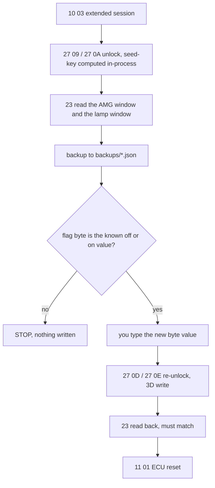

# ic204amg

Standalone tool to enable the **AMG instrument-cluster menu** on a Mercedes IC204 cluster
(W204/W212 and relatives) by a direct EEPROM write over UDS, through a Tactrix Openport 2.0
(J2534). Pure Python, 32-bit, Windows laptop, no Vediamo or Xentry at write time.

> [!WARNING]
> **This writes raw bytes to your instrument cluster's EEPROM.** That EEPROM also holds
> odometer and vehicle-binding data. A wrong offset, a wrong value, or an interrupted write can
> corrupt the cluster or brick it. The tool restricts itself to the configured AMG/lamp windows
> and verifies every write by read-back, but **you** are responsible for the values in your
> profile. Only use it on a cluster you own or are authorised to modify; odometer tampering is
> illegal in most jurisdictions. No warranty - see `LICENSE`. **Always `readonly` first and keep
> the backup.**

> [!IMPORTANT]
> **Sourcing.** Every non-obvious claim and hex value below is tagged with a source and a
> confidence tier:  
> `[S]` - read-from-source  
> `[V]` - verified on the author's car  
> `[C]` - community report seen only as a forum excerpt  
> `[I]` - inferred  
> See [Provenance](#provenance). Do not trust a `[C]` byte for your cluster without opening the thread and reading your own backup.

## Requirements

- **Car:** a Mercedes with an IC204-family instrument cluster (W204 C-Class and relatives such as
  W212, C207, C218). The write recipe is verified only on a W204 **colour** cluster `[V]`; other
  clusters need their own profile (see [Cluster coverage](#cluster-coverage)).
- **Interface:** a Tactrix Openport 2.0 (J2534) on the OBD port, with the Tactrix driver
  installed. The driver provides `C:\Windows\SysWOW64\op20pt32.dll`, which is all the tool uses.
- **Laptop:** Windows. The J2534 DLL is 32-bit Windows only; the release bundle ships its own
  32-bit Python, so nothing else is installed. Vediamo/Xentry are not needed, but if present they
  must be closed, the Openport is exclusive.
- **Power:** a charger holding the battery at ~13.5 V, ignition on, engine off. Writes are
  refused below 12.5 V.
- **Two facts about your cluster:** its CAN ids (known for IC_204, see below) and its 10-digit
  software part number, as Xentry/Vediamo/DAS show it in the IC204 identification. The part
  number selects the seed-key table; the tool refuses to run without it.

## Quick start

### 1. Install

Download `ic204amg-win32.zip` from the
[releases](https://github.com/MrExplode/IC204-AMG/releases) (the `bundle` GitHub Action builds
it from `tools/build_bundle.py`: embeddable 32-bit CPython 3.15 + udsoncan + this tool) and
unzip it anywhere on the laptop, e.g. `C:\work\amg`. Nothing is installed; delete the folder to
undo. To build it yourself, see [Develop](#develop).

### 2. Configure `car.toml`

In the unzipped folder, copy `car.example.toml` to `car.toml` and fill it in. Every key can
also be given on the command line (`--txid`, `--rxid`, `--baud`, `--sw`, `--dll`).

| Key | Section | Meaning | Where it comes from |
| --- | --- | --- | --- |
| `txid` | `[cluster]` | request CAN id | `CP_REQUEST_CANIDENTIFIER` in the cluster's CBF; `0x60A` for IC_204 `[S]` (`tools/cbf/ic204_comparams.txt`) |
| `rxid` | `[cluster]` | response CAN id | `CP_RESPONSE_CANIDENTIFIER`; `0x481` for IC_204 `[S]` |
| `baud` | `[cluster]` | CAN bit rate | `CP_BAUDRATE`; `500000` for IC_204 `[S]` |
| `sw` | `[cluster]` | the cluster's 10-digit software part number | IC204 identification in Xentry/Vediamo/DAS. `ic204amg selftest` lists the 42 supported numbers. A wrong one is a rejected key, and the cluster counts failed attempts |
| `dll` | `[openport]` | path of the J2534 DLL | the Tactrix driver; default `C:\Windows\SysWOW64\op20pt32.dll` |
| `[amg]`, `[lamp]` | | write recipe for clusters other than W204 colour | `car.example.toml` documents the fields; the values are community-reported and unverified, see [Cluster coverage](#cluster-coverage) |

If your cluster is not an IC_204, take the ids from its own CBF or a Vediamo channel trace
([how](#dumping-can-ids-from-a-cbf)). Never guess them.

### 3. Run

In the unzipped folder (`ic204amg.cmd` is there), in this order:

```
ic204amg selftest      # seed-key vectors, udsoncan, op20pt32.dll load, active profile; no cable
ic204amg probe         # cable: firmware/DLL version, battery voltage; no bus traffic
ic204amg readonly      # unlock + back up the profile's windows; writes nothing
ic204amg write [--expect backups\<earlier>.json]
ic204amg lampfix       # only if an ESP/CNG/preheat lamp misbehaves afterwards
ic204amg restore backups\<file>.json [--lamp]
```

Every writing command re-reads first, saves a fresh backup, refuses below 12.5 V
(`--ignore-battery` overrides) and asks you to type the new byte value. It unlocks again right
before the write, because security access lapses while that prompt waits. `write` toggles the
flag byte each run, so run it once; `lampfix` and `restore` are the follow-ups. The write unlock
defaults to SecurityAccess level `0x0D` - `0x09` was refused (`7F 3D 33`) on the author's cluster
`[V]`, reads still use `0x09`; if a write is refused try a different `--write-level` (choices
`0x01 0x03 0x09 0x0D`).

Exit codes: 0 ok, 1 usage/config, 2 STOP (a safety rule halted it), 3 UDS/transport error. Copy
`backups/` and `logs/` off the laptop after each session.

**Rollback:** `restore backups\<file>.json` writes the backed-up AMG window back (`--lamp` also
restores the lamp window). Since the tool only ever changes bytes it has a byte-exact copy of,
every state is reversible over OBD as long as the cluster still talks.

## What it does

The AMG menu on a non-AMG IC204 is software-only: the available pages live in EEPROM, not in
variant coding or flash `[C]`[^mhh-coding]. So this is a `WriteMemoryByAddress` (UDS `0x3D`) to a
small flag window, gated only by IC204 `SecurityAccess` - SCN never enters into it
`[C]`[^mcs]. Abrites gates its one-click IC204 AMG function behind the same MN030 licence as its
cluster mileage calibration `[S]`[^abrites-amg][^abrites-mn030], which *suggests* the write path
shares the odometer's EEPROM `[I]`.

You get an AMG page (engine/gearbox oil temp, gear, RACETIMER, depending on the bits); you do
**not** get any physical change - dial faces, needle colours and speedometer scaling are
untouched, and the verification steps prove it. On some cluster software the write has a side
effect (a wrong ESP/CNG/preheat indicator lamp); a second EEPROM window is the reported fix
(`lampfix`) `[C]`[^mcs][^autogmt-w204]. Some software versions ignore the flag entirely - that is
a firmware matter outside this tool `[C]`[^mbtools][^mhh-change].

### Sequence

What `write` sends; `readonly` stops after the backup.



P2/P2* come from the `50 03` reply. The command format and the `0x10000000`+ALFID-`14`
addressing are the community wire format `[C]`[^mcs]. TesterPresent is a firmware-side periodic
`3E 80`. The cluster only ever receives writes to the windows named in the active profile; every
PDU is logged to `logs/`.

### Confidence by part

| Part | Tier | Source |
| --- | --- | --- |
| Seed-key algorithm, SW→definition map, UDS level `09`→internal 5, test vectors | `[S]` | [jglim/UnlockECU][^unlockecu] (repo source, `Security/IC204.cs`, `IC204Tests.cs`) |
| Read/write command format, `0x10000000` address base, ALFID `0x14` | `[C]` | [MotorCarSoft][^mcs] |
| W204 **colour** cluster: AMG `0x01D0` byte 0 `FC`↔`FF` | `[V]` | enabled the AMG menu on the author's 2013 W204 colour cluster (SW `2049022903`, 2026-10); originally reported by [autogmt][^autogmt-w204] / [MHH p.12][^mhh-change] |
| Lamp fix: `0x0260` last byte → `0x60` | `[C]` | [MotorCarSoft][^mcs] |
| `67 09` seed response is the level-09 exchange | `[C]` | [autogmt W212][^autogmt-w212] |
| Write needs SecurityAccess `0x0D` where `0x09` is refused | `[V]` | observed on the author's cluster (`7F 3D 33` at `0x09`, 2026-10) |

Every **other** offset and byte value is community-reported and **unverified** - a starting
point only:

| Cluster | AMG byte(s) | Tier | Source |
| --- | --- | --- | --- |
| Monochrome | `0x01D0` bytes 0–1 = `10 20` | `[C]` | [MHH p.8][^mhh-p8] |
| W204 w/o Airmatic | `0x01D0` byte 0 = `40` | `[C]` | [MHH V2 p.4][^mhh-v2] |
| Factory-AMG clusters | `0x0212`–`0x0213` = `FF FF` | `[C]` | [MotorCarSoft][^mcs] |
| Pre-facelift mono (SW `2044421921`) | `10 20`/`40`/`60` → no change | `[C]` | [MHH p.12][^mhh-change] |

The monochrome `10 20` is a two-byte flag and is **not** expressible as the single-byte toggle
this tool uses.

## Cluster coverage

- **Seed-key `[S]`[^unlockecu]:** 42 software part numbers (37 salt tables + 5 aliases) across six
  firmware families (197902, 204442, 204902, 212442, 212902, 218902 → W204/W212/C207/W218),
  selected by the `sw` part number. `ic204amg selftest` lists them and reproduces the vectors
  (e.g. SW `2049022903` level 9, seed `5C97A0A552FB0205` → key `D8F169D68D5D17B6`
  `[S]`[^unlockecu-vectors]). Adding a variant is one salt table in `seedkey.py`.
- **CAN ids / baud / DLL / SW part number:** per cluster, in `car.toml`.
- **AMG recipe:** the write windows, the flag byte and the lamp fix are a *profile*. The default
  is W204 colour (the only `[V]` profile); override it with `[amg]`/`[lamp]` in `car.toml` (see
  `car.example.toml`). The write allow-list is built from the profile, so a new variant needs
  **no code change**.

### Dumping CAN ids from a CBF

udsoncan needs the cluster's request/response ids and baud; they are comparameters in the CBF.
`tools/cbf/CbfComParams.cs` dumps them using CaesarSuite's `Caesar.dll`. On a Windows machine,
in one folder: `CbfComParams.cs`, `build.cmd`, `Caesar.dll` and `Newtonsoft.Json.dll` (from
`CaesarSuite_2022-04-28.zip`, needs .NET Framework 4.6+), and the cluster's CBF:

```
build.cmd
CbfComParams.exe IC_204_Xentry.CBF IC_204 > ic204_comparams.txt
```
Take `CP_REQUEST_CANIDENTIFIER`, `CP_RESPONSE_CANIDENTIFIER`, `CP_BAUDRATE` of the HS-CAN
(UDS) subtype. The IC_204 dump is in `tools/cbf/ic204_comparams.txt`.

## Develop

Linux or macOS, [uv](https://docs.astral.sh/uv/):

```
uv sync                                  # .venv: python 3.15 (matches the bundle)
uv run pytest
uv run ruff format . && uv run ruff check . && uv run ty check
python3 tools/build_bundle.py            # dist/py + dist/ic204amg-win32.zip, stdlib only
```

`tools/build_bundle.py` downloads the embeddable CPython and the udsoncan wheel (sha256
checked), adds `ic204amg/`, `ic204amg.cmd` and `car.example.toml`, and needs nothing on the
laptop. The `bundle` GitHub Action runs the tests and builds the same zip on every push; pushing
a `v*` tag attaches it to a release.

## Layout

- `ic204amg/uds.py` - UDS request builders, NRC table, strict response checks
- `ic204amg/profile.py` - cluster profile: writable windows, flag-byte rule, lamp fix
- `ic204amg/transport.py` - Openport via udsoncan `J2534Connection`, firmware TesterPresent
- `ic204amg/cluster.py` - procedure, backup files, write allow-list, toggle/lamp/restore
- `ic204amg/seedkey.py` - IC204 seed-key algorithm; vectors in `VECTORS`
- `tests/` - pytest; `tests/fakes.py` scripted cluster (session gate, seed-key, windows)
- `tools/build_bundle.py`, `tools/cbf/`

## Provenance

Confidence tiers used above:  
**`[S]`** read from a primary source (open-source code/tests)  
**`[V]`** verified on the author's car (2013 W204, colour cluster, SW `2049022903`, Oct 2026)  
**`[C]`** community report seen only as a forum search-result excerpt - **unverified**  
**`[I]`** inferred  
The UnlockECU facts were read from the repository itself. The MHH and MotorCarSoft pages block 
automated reading, so their bytes here come from search excerpts only -
**open the thread and read your own backup before trusting a specific value.** Reports disagree
even on the direction of the colour-cluster byte, which is why the tool reads first, toggles
against your own value, and stops on anything unexpected.

## Credits & license

MIT licensed (`LICENSE`). The IC204 seed-key algorithm, salt constants and test vectors are
those of [jglim/UnlockECU][^unlockecu] (MIT); the reverse engineering is also documented at
[Mattwmaster58/ic204](https://github.com/Mattwmaster58/ic204). UDS transport uses
[udsoncan](https://github.com/pylessard/python-udsoncan).

[^unlockecu]: jglim/UnlockECU - IC204 provider, definitions, access levels, level mapping. <https://github.com/jglim/UnlockECU>
[^unlockecu-vectors]: UnlockECU IC204 test vectors. <https://github.com/jglim/UnlockECU/issues/10>
[^mcs]: MotorCarSoft - UDS read/write command format, `0x10000000` mapping, `0x0260` lamp fix, `0x0212`–`0x0213` factory AMG (excerpt). <https://www.motorcarsoft.com/viewtopic.php?t=21528>
[^abrites-amg]: Abrites - activate AMG menu, IC204 support, MN030 licence requirement. <https://abrites.com/news/activate-amg-menu-in-mercedes-benz-vehicles-in-just-a-few-clicks>
[^abrites-mn030]: Abrites - MN030 is the mileage-calibration licence. <https://abrites.com/news/ic172-and-ic204-fbs4-mercedes-benz-dashboards-added-for-support-in-the-mn030-license>
[^autogmt-w204]: autogmt - colour-cluster byte `FC`→`FF`, CNG/ESP side effect. <https://autogmt.com/threads/who-can-help-me-to-activate-the-amg-menu-w204.236/>
[^autogmt-w212]: autogmt - `67 09` seed response (excerpt). <https://autogmt.com/threads/w212-amg-menu.2205/>
[^mbtools]: MBTools AMG guide - unlock timing, firmware-flash caveat. <https://mbtools.com/guide/amg>
[^mhh-coding]: MHH - IC204 AMG pages set in EEPROM, not coding or flash (excerpt). <https://mhhauto.com/Thread-Ic204-replace-coding>
[^mhh-change]: MHH - `FF`→`FC` colour case and no-effect pre-facelift mono (excerpt). <https://mhhauto.com/Thread-W212-W204-AMG-IC-instrument-cluster-change?page=12>
[^mhh-p8]: MHH - monochrome `10 20` values (excerpt). <https://mhhauto.com/Thread-AMG-menu-for-free-CNG-or-preheat-lamp-fix?page=8>
[^mhh-v2]: MHH - `40` value, EEPROM via OBD after seed-key (excerpt). <https://mhhauto.com/Thread-FREE-AMG-MENU-V2-IC204-204-212?page=4>
